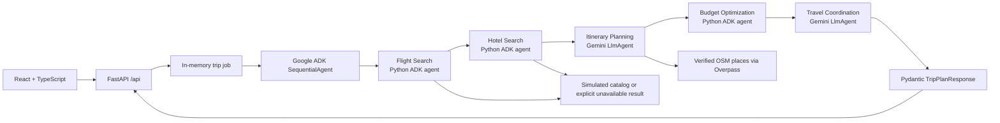

# Wayfinder: Multi-Agent Travel Planner

An educational travel-planning application with a React interface, a small FastAPI backend, and a five-stage Google ADK workflow. Gemini interprets travel interests and explains the plan; Python retrieves the available data, validates trip facts, and calculates every budget figure. The project runs locally, but **AI Agent Mode calls the Gemini API**. No Ollama, database, Docker, paid model, or booking service is required.

**Flight and hotel offers for the built-in sample routes are simulated and non-bookable.** Other routes use named OpenStreetMap places where available, with flight, hotel, and admission prices left unknown unless the traveler supplies cost allowances. A partial estimate is never presented as a complete budget.

## Features

- Search worldwide cities through Open-Meteo and choose a specific city, region, and country.
- Plan a 2–14 day trip with dates, travelers, rooms, budget, interests, pace, and preferences.
- See flights, hotels, a day-by-day itinerary, budget charts, map markers for verified places, and an optional execution trace.
- Compare the initial and revised sample budgets using the existing Python optimizer.
- Follow real ADK progress through an in-memory FastAPI job. Technical details stay behind the Developer diagnostics panel.
- Use the preserved Streamlit **Offline Demo** without a key. Its output is a deterministic demonstration, not AI agent execution.

## Architecture



The five agents run in order and exchange **validated ADK session state**. Flight and Hotel stages execute their existing Python search tools every time and emit observed ADK tool events. The Itinerary Agent makes one Gemini request to select interest tags or verified attraction IDs, then calls `suggest_activities()`. Python grounds its tool arguments in the original request. The Budget Agent checks the returned data, calls `estimate_budget()` for sample routes or `partial_budget()` for global routes, and makes at most one optimization pass. The Coordinator makes one Gemini request to explain the structured facts. Its prose is separate from the typed response used by React; it never supplies prices to the budget calculator.

This workflow uses **two model requests** on a successful sample trip: Itinerary and Coordinator. The other stages are real ADK agents with deterministic Python behavior. It uses sequential orchestration and shared state, not `AgentTool` delegation. This is intentional: mandatory searches cannot be skipped by a model. The offline demo is a separate Python pipeline.

## Technology

| Layer | Tools |
|---|---|
| Web | React 18, TypeScript, Vite, Tailwind CSS 4, shadcn/ui components, Lucide React, Recharts, MapLibre GL JS |
| API | FastAPI, Pydantic, in-memory asyncio jobs |
| Agents | Google ADK, Gemini API, existing Python search, itinerary, budget, and replanning tools |
| Geographic data | Open-Meteo Geocoding, OpenStreetMap via Overpass, OpenFreeMap tiles |
| Tests | Pytest, Vitest, React Testing Library |

The map uses [OpenFreeMap's public style](https://openfreemap.org/) through MapLibre and keeps the built-in attribution control. Markers are shown only for coordinates returned by the geographic provider; synthetic demo activities have no map markers.

## Install and run

Use Python **3.11+** and Node.js **22.12+**. Commands below run from this repository directory in Windows PowerShell. Keep `travel_planner/.env` private; `.gitignore` excludes it.

```powershell
py -3 -m venv .venv
.\.venv\Scripts\python.exe -m pip install -r requirements.txt
Copy-Item .env.example travel_planner\.env
```

Edit `travel_planner/.env` and set your own `GOOGLE_API_KEY`. The template sets `GOOGLE_GENAI_USE_VERTEXAI=FALSE` and `GEMINI_MODEL=gemini-3.1-flash-lite`. This model completed the live workflow with the configured key and has a [documented free tier and function calling](https://ai.google.dev/gemini-api/docs/models/gemini-3.1-flash-lite). You can set `GEMINI_MODEL` to another free-tier-compatible Gemini model available to your project. Gemini availability and [rate limits](https://ai.google.dev/gemini-api/docs/rate-limits) vary by project. Do not enable billing for this learning project.

Start the backend in one terminal:

```powershell
.\.venv\Scripts\python.exe -m uvicorn backend.main:app --host 127.0.0.1 --port 8000
```

Start the frontend in another terminal:

```powershell
cd frontend
npm ci
npm run dev
```

Open `http://localhost:5173`. Vite proxies `/api` to FastAPI. The API documentation is at `http://127.0.0.1:8000/docs` and `GET /api/health` shows the selected model and whether a key is configured, without revealing the key. Use **one backend process**: trip jobs live only in memory and disappear when it restarts.

The preserved Streamlit fallback is optional. From the repository root:

```powershell
.\.venv\Scripts\python.exe -m streamlit run app.py
```

Choose **Offline Demo** to use only deterministic Python tools. For that mode alone, `requirements-demo.txt` can be installed in a separate virtual environment without Google ADK or a Gemini key. Streamlit's AI mode uses the same ADK/Gemini workflow as FastAPI.

## Example trip and result

Choose **Chicago, Illinois, United States → New York, New York, United States**, December 15–19, 2026, two travelers, one room, a $2,000 budget, and culture/food interests. The sample route yields five calendar days and four hotel nights:

| Estimate | Original | Optimized |
|---|---:|---:|
| Simulated round-trip flights | $660 | $660 |
| Simulated hotel stay | $920 | $640 |
| Food | $450 | $450 |
| Ground transport | $100 | $100 |
| Illustrative activities | $140 | $140 |
| **Total** | **$2,270** | **$1,990** |

The Python optimizer saves **$280** by selecting a cheaper returned sample hotel. The final estimate is $10 below the requested budget before taxes and fees. Flight and hotel names, offers, and prices are fictional; nothing can be booked from this app. The five daily activity suggestions are illustrative. See the [completed Gemini/ADK trace](docs/gemini-lite-live-check.json) for the exact calls and resulting plan.

For a global route such as Chicago → Rome, the city picker resolves a specific Rome, Italy record, then Overpass supplies named attractions and coordinates. The itinerary distinguishes those verified places from flexible suggestions. Flight and hotel offers remain unavailable. Optional traveler-entered allowances can add to the known subtotal, while unknown admission costs keep the overall budget **partial**, without a within-budget verdict.

## API and testing

| Endpoint | Purpose |
|---|---|
| `GET /api/health` | Backend status and model configuration |
| `GET /api/locations/search?q=Rome` | Up to five disambiguated city matches |
| `POST /api/trips/plan` | Validate input and start an ADK job |
| `GET /api/trips/{id}/status` | Queued/running/completed/failed and observed progress |
| `GET /api/trips/{id}/result` | Typed plan, pending status, or structured failure |

The frontend's TypeScript contract is generated from the FastAPI OpenAPI schema (`frontend/src/types/generated.ts`). After changing backend schemas, regenerate `frontend/src/types/openapi.json` from `backend.main.app.openapi()` and run `npm run types:generate` in `frontend`.

```powershell
.\.venv\Scripts\python.exe -m pytest -q
cd frontend
npm run check
npm run test
npm run build
```

To inspect a bounded **live** sample run without the UI:

```powershell
.\.venv\Scripts\python.exe -m scripts.verify_workflow --budget 2000 --interests culture,food --timeout 75 --output docs\my-live-check.json
```

Automated tests use fake Gemini responses and mock external geography; they do not consume API quota. The HTTP-to-ADK integration test submits a trip job, runs all five ADK stages, checks observed tool events, and validates the structured API result. React tests exercise form submission, status polling, results, and hidden diagnostics.

## Verification and limitations

- A bounded live run with `gemini-3.1-flash-lite` completed in **34.19 seconds**. The trace records `search_flights`, `search_hotels`, `suggest_activities`, two `estimate_budget` calls, and the final Coordinator response. Its model metrics record one Itinerary and one Coordinator request. The optimized $1,990 total and $280 savings came from Python.
- A second live check went through Vite's `/api` proxy: Open-Meteo resolved Chicago and New York, FastAPI returned a completed job, and the typed result contained the same five-day/four-night budget regression and all observed ADK stages. See the [HTTP journey summary](docs/gemini-http-check.json). React component tests cover form submission, polling, and result rendering; browser automation was unavailable here, so a rendered browser click-through and screenshot are not claimed.
- The requested `gemini-2.5-flash` returned **404 unavailable to new users** for this key. `gemini-3.8-flash` returned a temporary **503 high demand**. The configurable default is the free-tier-compatible model that completed the live run. See [Gemini model availability and pricing](https://ai.google.dev/gemini-api/docs/pricing).
- Live Open-Meteo lookup resolved Rome, Italy. Both tested public Overpass instances timed out in this environment. Global attraction retrieval, itinerary personalization, no-fabricated-price behavior, and provider failures are covered by mocked tests; **a complete live Rome run is not verified**.
- Public geographic services can be slow or unavailable. Search results, OSM tags, attraction descriptions, and coordinates are not guarantees of admission, opening hours, accessibility, or current conditions. Arrival and departure days keep only one optional named visit because travel times are unknown.
- Sample fares, lodging, activity costs, and food/transport allowances are teaching examples. Taxes and fees are excluded. No booking, live inventory, or guaranteed budget is provided.
- Jobs are local memory only; restarting the backend loses them. Google ADK currently warns that `SequentialAgent` is deprecated. The project keeps the existing five-stage architecture for clarity.
- The frontend production dependency audit is clear. One moderate `minimatch` advisory remains across three packages in the development-only `openapi-typescript` chain; it does not ship in the browser bundle. Regenerate types only from this project's trusted local OpenAPI schema.

## Repository guide

```text
frontend/                       React form, results, map, charts, tests, generated API types
backend/main.py                 FastAPI routes and in-memory jobs
travel_planner/agent.py         Five ADK stages
travel_planner/retrieval_agents.py Mandatory Python flight/hotel ADK stages
travel_planner/budget_agent.py   Python budget and optimization ADK stage
travel_planner/coordination.py   Validated shared-state handoffs and model callbacks
travel_planner/runner.py         Event trace, progress, timeout, and execution checks
travel_core/api_schemas.py       Typed HTTP request/response contract
travel_core/geo.py               Open-Meteo and Overpass clients
travel_core/global_planner.py    Verified-place itinerary and partial budget
travel_core/tools.py             Existing travel and budget tools
app.py                           Preserved Streamlit fallback
scripts/verify_workflow.py       Bounded live ADK verification
tests/                          Python unit and integration tests
```
